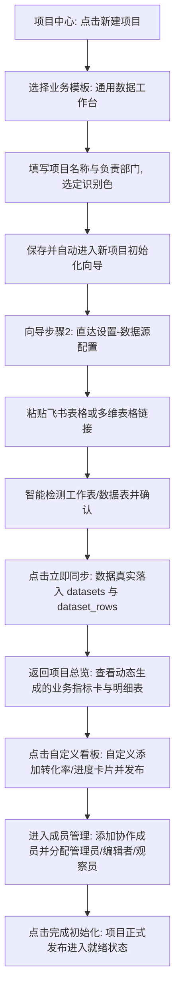
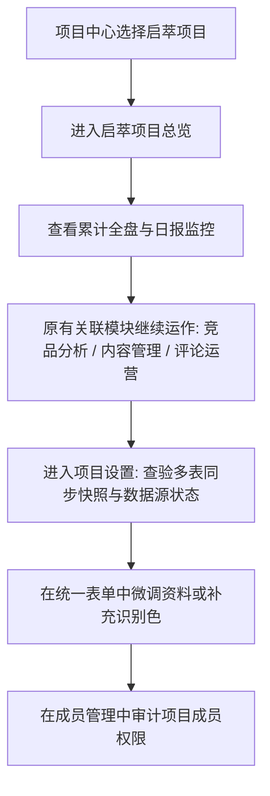

# 关键业务用户路径验证 (USER FLOWS)

## 路径 A：新部门从零开始接入业务与度量

### 真实操作体验保障：
1. **无需理解底层代码**: 用户不需要了解 Sheet ID、范围（A1:AZ5000）或 JSON 映射规则，直接贴链接智能探测并下拉选择工作表；
2. **直达任务目标**: 所有向导按钮均直达对应的功能 Tab，无需二次导航；
3. **真实数据展现**: 同步完成后即可在看板中实时计算出指标，并能在“数据明细”中直接检索和分页查看原始记录；
4. **多成员分权协作**: 管理员、业务编辑者与只读成员权限边界清晰，敏感配置受控。

---

## 路径 B：已有启萃项目的平稳过渡与深度使用

### 兼容性与不回退保障：
1. **历史数据 100% 保留**: 笔记总数（1335 篇）、私有隔离属性（1333 篇）、舆情处置评论（225 条）、供应商交付核验（175 条）全部完好；
2. **核心业务指标 100% 对账一致**: 历史采买支出合计 ¥5,113,124 精确对账；
3. **原有高级图表继续可用**: 达人层级分布、KFS 堆叠趋势、散点笔记画像与箱线图等组件完整保留。